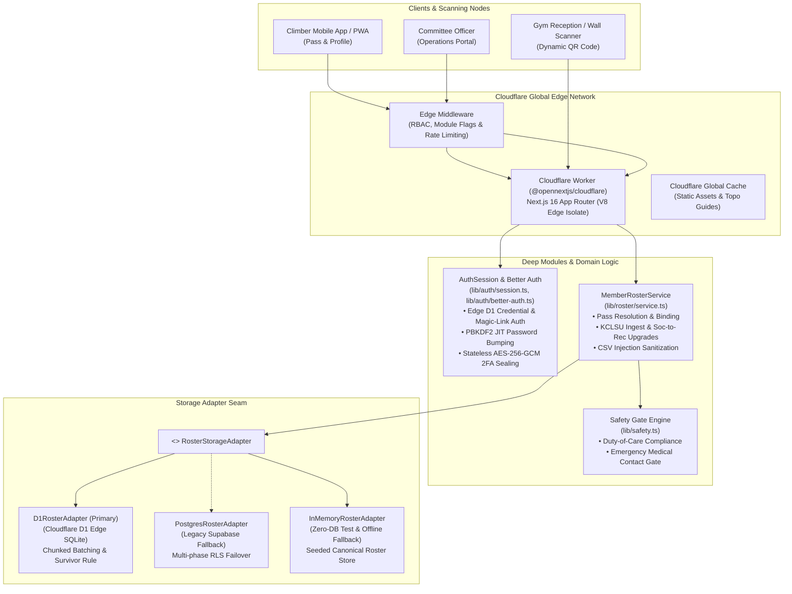

# King's College London Mountaineering Club (KCLMC) Platform

[](https://nextjs.org/)
[](https://www.typescriptlang.org/)
[](https://workers.cloudflare.com/)
[](https://developers.cloudflare.com/d1/)
[](https://www.better-auth.com/)
[-6E9F18?style=flat&logo=vitest)](https://vitest.dev/)
[](tests/security.test.ts)
[](docs/LEGAL_COMPLIANCE_AND_RISK_AUDIT.md)

The official digital infrastructure, member pass engine, and operations platform for the **King's College London Mountaineering & Climbing Club (KCLMC)** (accredited society of King's College London Students' Union, Registered Charity No. 1136729) and the **London Universities Bouldering Event (LUBE)** multi-university league.

**Author & Lead Engineer**: [Remy Preston](https://github.com/RemTypes)  
**Live Production**: [kclmc.org](https://kclmc.org) • **Edge Previews**: Automatic Cloudflare Workers preview environments created per Pull Request  
**Architecture Document**: [docs/ARCHITECTURE.md](docs/ARCHITECTURE.md) • **Domain Model**: [GLOSSARY.md](GLOSSARY.md)

---

## System Architecture



---

## Engineering Highlights & Key Architectural Decisions

### 1. Edge-First Deployment via Cloudflare OpenNext & D1
Deployed to **Cloudflare Workers** using [`@opennextjs/cloudflare`](https://opennext.js.org/cloudflare) backed natively by **Cloudflare D1 (Edge SQLite)**. Server-side rendering (SSR), API route handlers, and middleware execute in lightweight, globally distributed V8 edge isolates with sub-10ms database read times.

### 2. Deep-Module Architecture
Constructed following deep-module engineering principles—maximizing leverage by offering simple, expressive interfaces that conceal substantial operational complexity:
- **[`MemberRosterService`](lib/roster/service.ts)**: A single module orchestrating multi-phase database lookups, cross-table student ID bindings, automated "Social-to-Recreational" upgrade state resolution (Survivor Rule), CSV formula injection defense, and circuit-breaker storage failovers.
- **[`AuthSession`](lib/auth/session.ts)**: A unified authentication module integrating **Better Auth** on Cloudflare D1 with JIT PBKDF2 password hash bumping (`lib/security/password-hasher.ts`), sliding-window rate limiting, exponential backoff, CAPTCHA threshold triggers, mandatory committee 2FA checks, and cookie lifecycle management.

### 3. Storage Adapter Seams for Zero-Downtime Offline Resilience
Persistence is decoupled behind the [`RosterStorageAdapter`](lib/roster/service.ts) interface ([ADR 0002](docs/adr/0002-storage-adapter-seam-for-roster.md)):
- **`D1RosterAdapter` ([`lib/roster/d1-adapter.ts`](lib/roster/d1-adapter.ts))**: Primary production adapter executing parameterized SQLite queries and chunked `db.batch()` transactions against Cloudflare D1 (`kclmc-production`).
- **`PostgresRosterAdapter`**: Legacy transition adapter for Supabase PostgreSQL failover.
- **`InMemoryRosterAdapter`**: Test-isolated, zero-dependency in-memory adapter backed by canonical seed data. Powers both offline climbing wall scan verification and the automated test suite without network calls.

### 4. Stateless AES-256-GCM 2FA Challenges Across Edge Isolates
To eliminate database connection overhead and cross-isolate state loss on Cloudflare Workers, pending two-factor authentication challenges are encrypted using **AES-256-GCM** authenticated tags with deterministic cross-isolate key derivation and stored in a short-lived (5-minute TTL), `httpOnly`, `SameSite=Lax`, `Secure` cookie ([ADR 0001](docs/adr/0001-stateless-aes-gcm-2fa-challenges.md)). Committee 2FA verification runs in an isolated `2fa:${ip}` rate-limit bucket with $\pm 2$ step ($\pm 60\text{s}$) RFC 6238 TOTP drift tolerance.

### 5. Zero-Trust Duty-of-Care Safety Gate
In mountaineering, safety compliance is a legal necessity. The platform features an automated **Safety Gate** ([`lib/safety.ts`](lib/safety.ts)) enforcing UK climbing wall duty-of-care: a member's digital climbing pass remains locked and scanners flag it as incomplete until verified mobile numbers and emergency contact details are provided.

### 6. Defense-in-Depth Security Suite (OWASP Top 10)
Backed by an automated 90-test security testing suite ([`tests/security.test.ts`](tests/security.test.ts)):
- **Brute-Force & Lockout**: Dual-keyed sliding-window rate limiter (`cf-connecting-ip` prioritized + email) with exponential backoff after 3 failed attempts, Cloudflare Turnstile CAPTCHA verification, and 15-minute account lockout after 5 failures.
- **Timing Attack Resistance**: Cryptographic comparisons for OTP tokens, backup codes, and signatures utilize constant-time `crypto.timingSafeEqual`.
- **CSV Formula Injection Mitigation**: Sanitizes untrusted spreadsheet cells starting with `=`, `+`, `-`, or `@` during sales reconciliation exports.
- **PII Redaction & SQL Bounds**: Public pass verification (`/api/verify/[membershipId]`) masks student IDs to the last 3 digits, strips internal union transaction IDs, and enforces strict regex bounds (`^[A-Z0-9_-]{3,32}$`).

### 7. Machine Learning Pipeline for Club Stash Pre-Orders
Located in [`ml/`](ml/) and gated behind SuperAdmin clearance (`role >= 2`) at `/admin/ml`:
- **Demand Elasticity Modeling (`ml/01_demand_elasticity.py`)**: Estimates price elasticity ($\epsilon$) across historical apparel sales to forecast pre-order volumes and break-even Minimum Order Quantity (MOQ) thresholds.
- **Sizing Distribution Optimization (`ml/02_sizing_optimization.py`)**: Uses historical apparel sizing and university demographic distributions to calculate optimal garment size ratios (XS–XXL), reducing overstock waste.

---

## Tech Stack

| Layer | Technology | Purpose |
| :--- | :--- | :--- |
| **Framework** | [Next.js 16 (App Router)](https://nextjs.org/) + [React 19](https://react.dev/) | Server Components, Streaming SSR, and dynamic route handlers |
| **Language** | [TypeScript](https://www.typescriptlang.org/) | Strict mode type safety across entire domain and data models |
| **Edge Runtime** | [Cloudflare Workers](https://workers.cloudflare.com/) + [`@opennextjs/cloudflare`](https://opennext.js.org/cloudflare) | Sub-10ms global edge compute with static asset offloading |
| **Database** | [Cloudflare D1](https://developers.cloudflare.com/d1/) (Edge SQLite) | Unified edge relational storage (`d1/schema.sql`) |
| **Authentication** | [Better Auth](https://www.better-auth.com/) + Custom TOTP 2FA | Kysely D1 adapter, PBKDF2 password hashing, Magic Links & RFC 6238 2FA |
| **Styling & UI** | [Tailwind CSS v3](https://tailwindcss.com/) + [Lucide Icons](https://lucide.dev/) | Custom Alpine Forest (`#052322`) and Summit Gold (`#FFBD59`) theme |
| **Animation** | [Framer Motion](https://www.framer.com/motion/) | Pass rendering, accordion states, and transitions |
| **Testing** | [Vitest](https://vitest.dev/) | 22 test suites (328 unit, integration, and security tests) |
| **Analytics & ML** | [Python 3.11](https://www.python.org/) + `scipy` / `numpy` | Merch demand elasticity and sizing distribution models |
| **Email Gateway** | SMTP via [Purelymail](https://purelymail.com/) | Transactional auth emails & BMC insurance dispatches |

---

## Key Modules & Codebase Directory Map

```text
kclmc-portal/
├── app/                              # Next.js 16 App Router Routes
│   ├── (auth)/                       # Unified authentication, 2FA & password reset
│   ├── (kclmc)/                      # Public club pages, guides, meets & stash
│   ├── (lube)/                       # London University Bouldering Event (LUBE) league
│   ├── admin/                        # Committee Management Suite (RBAC >= 1)
│   │   ├── bmc/                      # BMC insurance mail-merge & dispatch tracking
│   │   ├── content/                  # CMS for crags, gyms, meets, products & bio links
│   │   ├── export/                   # GDPR-compliant CSV & vCard contact exports
│   │   ├── ml/                       # Stash demand elasticity & sizing forecasts (Role >= 2)
│   │   ├── reconcile/                # KCLSU CSV roster reconciliation engine
│   │   └── scan/                     # Wall receptionist QR pass camera scanner
│   └── api/                          # High-throughput Edge API Route Handlers
│       ├── auth/                     # Better Auth [...all], login, signup, 2FA & reset endpoints
│       ├── links/                    # Bio links directory API (/links)
│       ├── membership/               # Pass resolution & duty-of-care safety updates
│       ├── orders/                   # Merch order state machine & QR collection
│       ├── roster/                   # Committee member directory & CSV sync
│       ├── roster/link/              # Student ID claiming & union validation
│       └── verify/[membershipId]/    # Rate-limited public wall scanner pass verification
├── d1/
│   └── schema.sql                    # Authoritative Cloudflare D1 SQLite schema & seed links
├── lib/
│   ├── auth/
│   │   ├── better-auth.ts            # Better Auth Kysely D1 engine & magic link configuration
│   │   ├── server.ts                 # Universal D1 Better Auth + fallback session resolver
│   │   └── session.ts                # Deep AuthSession & 2FA Challenge module
│   ├── db/d1.ts                      # Cloudflare D1 binding & context resolver
│   ├── roster/
│   │   ├── d1-adapter.ts             # Primary Cloudflare D1 storage adapter
│   │   └── service.ts                # Deep MemberRosterService & storage adapter seams
│   ├── security/                     # Rate limiting, PBKDF2 hasher, password policy, cookies & 2FA
│   ├── bmc_insurance.ts              # BMC liability insurance & mail-merge parsing
│   └── safety.ts                     # Duty-of-care completeness gatekeeper
├── docs/
│   ├── ARCHITECTURE.md               # Detailed system architecture & design document
│   ├── COMMITTEE_HANDOVER_MANUAL.md  # Complete committee operations manual
│   ├── DATABASE_PRUNING_PLAN.md      # D1 schema optimization & lifecycle plan
│   ├── LEGAL_COMPLIANCE_AND_RISK_AUDIT.md # UK GDPR & statutory compliance audit
│   ├── PRODUCTION_REVIEW_REPORT.md   # Comprehensive production security & parity audit
│   └── adr/                          # Architectural Decision Records (ADRs)
├── ml/                               # Demand elasticity & garment sizing optimization
├── scripts/                          # Database backup, Supabase->D1 sync & copy hygiene scripts
├── tests/                            # Automated Vitest test suites (22 suites / 328 tests)
└── wrangler.jsonc                    # Authoritative Cloudflare Workers & D1 configuration
```

---

## Quality Assurance & Automated Testing

The platform enforces strict test-driven reliability with **22 test suites** and **328 passing automated tests**:

```bash
# Run entire test suite (unit, integration & security)
npm test

# Run dedicated OWASP security audit suite (90 tests)
npm run test:security

# Run frontend copy & hygiene check
npm run check:frontend-copy

# Run TypeScript strict typecheck
npx tsc --noEmit
```

---

## Getting Started & Local Development

### Prerequisites
- Node.js 20+ (LTS)
- npm 10+

### Setup

```bash
# 1. Clone repository
git clone https://github.com/RemTypes/kclmc-portal.git
cd kclmc-portal

# 2. Install dependencies
npm install

# 3. Configure environment variables (optional for local mock mode)
cp sample.env .env.local

# 4. Start local development server
npm run dev
```

Visit [http://localhost:3000](http://localhost:3000) to view the portal. The application includes a self-contained in-memory fallback layer, allowing full browsing, climbing pass resolution, and testing without requiring external database credentials.

### Production Edge Build

```bash
# Build Cloudflare OpenNext worker bundle (.open-next/worker.js)
npm run build:worker

# Deploy to Cloudflare Workers (via Wrangler)
npm run deploy:cloudflare
```

---

## Documentation Index

- **[System Architecture & Design Document](docs/ARCHITECTURE.md)**: Deep dive into module interfaces, data flow, D1 adapters, security, and edge mechanics.
- **[Domain Model & Terminology (GLOSSARY.md)](GLOSSARY.md)**: Ubiquitous language dictionary for society concepts.
- **[Committee Operations & Handover Manual](docs/COMMITTEE_HANDOVER_MANUAL.md)**: Comprehensive tenure transition guide, D1 schemas, and workflows.
- **[Database Pruning & Optimization Plan](docs/DATABASE_PRUNING_PLAN.md)**: Phased roadmap for index deduplication, legacy table retirement, and telemetry retention.
- **[Legal Compliance & Risk Audit](docs/LEGAL_COMPLIANCE_AND_RISK_AUDIT.md)**: UK GDPR Art. 32, ICO fee exemptions, and BMC liability notices.
- **[ADR 0001: Stateless AES-GCM 2FA Challenges](docs/adr/0001-stateless-aes-gcm-2fa-challenges.md)**: Architectural rationale for edge multi-isolate 2FA.
- **[ADR 0002: Storage Adapter Seam for Roster](docs/adr/0002-storage-adapter-seam-for-roster.md)**: Architectural rationale for pluggable persistence across D1, Postgres, and In-Memory stores.

---

## Author

**Remy Preston**  
*Lead Architect & Full-Stack Engineer*  
- **GitHub**: [@RemTypes](https://github.com/RemTypes)  
- **Email**: [remy.preston@outlook.com](mailto:remy.preston@outlook.com) / [remy.preston@kcl.ac.uk](mailto:remy.preston@kcl.ac.uk)  

---

## License

This project is licensed under the [MIT License](LICENSE).
