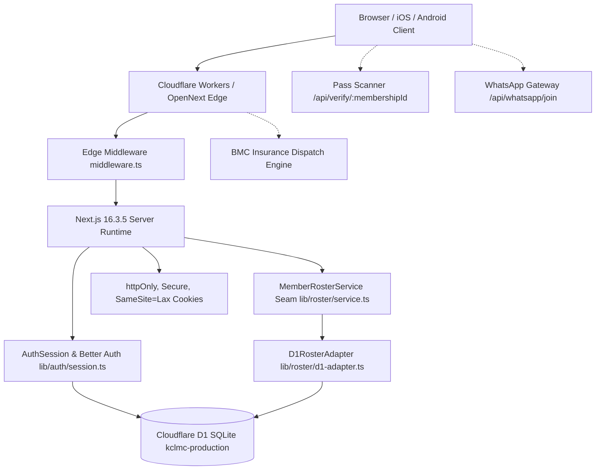

# KCLMC Platform: Comprehensive Session Handover & Architecture Guide

> **Last Updated**: November 2026 (Season 2026–2027)  
> **Repository Directory**: `/home/rem/Projects/kclmc-portal`  
> **Active Branch**: `epic/replace-supabase` (Synchronized with `origin/epic/replace-supabase`)  
> **Test Status**: **328 / 328 passing** across 22 suites (`npm test`) | **90 / 90 security tests passing** (`npm run test:security`)  
> **Frontend Copy Audit**: **0 errors** (`npm run check:frontend-copy`)  
> **Edge Bundle**: Built and verified (`npm run build:worker` -> `.open-next/worker.js`)  
> **Cloudflare D1 Database**: `kclmc-production` (`25583bc2-683b-49ac-a5c0-2419a66f651a`) — 100% synced (192 users, 190 profiles, 287 roster members)  
> **Live Deployments**: [kclmc.org](https://kclmc.org) • [epic-replace-supabase.kclmc.org](https://epic-replace-supabase.kclmc.org)

---

## 1. Executive Summary & Project Purpose

The **KCLMC Platform** is the official digital infrastructure for the **King's College London Mountaineering & Climbing Club (KCLMC)**, an accredited student society of King's College London Students' Union (KCLSU, Registered Charity No. 1136729).

### Core Features & Modules
1. **Digital Climbing Membership Pass (`/membership`)**:
   - Real-time pass issuance for active student climbers with cryptographic QR code validation for partner climbing walls and trip leaders.
   - Matches against the official Cloudflare D1 `kclsu_roster` table (287 active members across Social and Recreational tiers).
   - **Anti-Forgery & Blank Card Protection**: Card template rendered with CSS `background-image` and touch-callout suppression (`-webkit-touch-callout: none`, `pointer-events: none`) to prevent blank template extraction on mobile long-press.
   - **Cross-Platform Save**: Native Web Share API (`navigator.share`) with Canvas Blob fallback for seamless saving to Apple Photos / Android Gallery.
2. **Compulsory Safety Gate & Emergency Directory (`/safety`)**:
   - Hard gating of digital passes behind compulsory BMC Climbing Risk Statement acknowledgment.
   - Collects member phone number and emergency contact (name, phone, relationship) before pass activation.
   - UK GDPR-compliant emergency directory in the admin portal for trip leaders and safety officers.
3. **British Mountaineering Council (BMC) Insurance System (`/admin/bmc`, `/api/admin/bmc-insurance`)**:
   - Automated BMC recreational member civil liability insurance declaration workflow backed by D1 `bmc_dispatches`.
   - Prevents duplicate declarations, issues verification badges on digital passes.
4. **Leak-Proof WhatsApp Community Gateway (`/api/whatsapp/join`)**:
   - Server-side gateway protecting society WhatsApp group links from public search indexing and web scrapers.
   - Restricts community invite access strictly to verified, authenticated members with paid passes.
5. **Where We Climb (`/guides`)**:
   - Comprehensive guide directory for London indoor climbing centres (Mile End, Castle, Parthian, VauxWall, Bermondsey Wall, HarroWall) with exclusive student discount information and crag beta.
6. **Apparel Drops & Stash (`/drops/kclmc`, `/drops/lube`)**:
   - Group-buy merchandise pre-order system with live MOQ tracking, feature-module guards (`gearMerch`, `dropsLube`), and QR order collection (`pending`, `paid`, `fulfilled`, `collected`, `cancelled`, `refunded`).
7. **Bio Links Directory (`/links`)**:
   - Mobile-first Linktree alternative in KCLMC Green & Gold (`#041F1E`, `#052322`, `#FFBD59`), backed by D1 `portal_links` and managed via `/admin/content`.
8. **Associate Member System (`ASSOC-26XX`)**:
   - Dedicated custom ID generator and membership linking toggle for non-King's climbers (alumni, UoL, staff, guests).
9. **Committee Administration Portal (`/admin`)**:
   - **Payment Reconciliation (`/admin/reconcile`)**: CSV reconciliation engine matching KCLSU payment reports against D1 `kclsu_roster` using chunked `db.batch()` writes and the Survivor Rule.
   - **Pass Scanner (`/admin/scan`)**: Mobile QR and barcode scanner for committee check-ins and merch collection.
   - **Content Manager (`/admin/content`)**: Manage trips, guides, merchandise drops, and bio links.
   - **Manufacturer Export (`/admin/export`)**: Sizing matrix generator for garment printers and structured vCard generation (`KCLMC 26/27`).
   - **Machine Learning Forecasts (`/admin/ml`)**: Demand elasticity and sizing optimization dashboards gated to SuperAdmin (`role >= 2`).

---

## 2. Technology Stack & Edge Architecture



- **Framework**: Next.js 16.3.5 (App Router, webpack bundler).
- **Edge Deployment**: Cloudflare Workers via OpenNext (`@opennextjs/cloudflare` v1.20.6, `workerd` compatibility date `2026-06-12`), configured in [`wrangler.jsonc`](wrangler.jsonc).
- **Database & Auth**: Cloudflare D1 (`kclmc-production`, SQLite schema in [`d1/schema.sql`](d1/schema.sql)) + Better Auth (`kysely-d1`) + PBKDF2 JIT password bumping (`lib/security/password-hasher.ts`) + RFC 6238 TOTP 2FA (`lib/security/two-factor.ts`).
- **Styling**: Tailwind CSS 3.4.19, custom topo pattern textures, brand typography (Barlow Condensed, Inter, Space Mono).

---

## 3. Key Architectural Implementations & Security Hardening

### A. Authentication, Better Auth & Cross-Isolate 2FA
1. **`AuthSession` Deep Module (`lib/auth/session.ts`)**:
   - Encapsulates Better Auth D1 credential validation, JIT PBKDF2 password hash bumping for migrated accounts (`MIGRATED_ACCOUNT`), rate limiting, and mandatory committee 2FA challenge handling.
2. **Cross-Isolate 2FA Challenge Sealing & Rate-Limit Isolation (`lib/security/two-factor.ts`)**:
   - Mandatory for Committee / Admin Accounts (`role >= 1`) when `ENFORCE_MANDATORY_2FA=true`.
   - `sealChallenge` and `unsealChallenge` share a deterministic candidate key hierarchy so challenges sealed on one Cloudflare Worker isolate always unseal cleanly on any other isolate without relying on isolate-local memory.
   - Widened RFC 6238 TOTP verification window to $\pm 2$ steps ($\pm 60\text{s}$) to tolerate mobile clock drift.
   - Primary password success clears login failure counters and isolates 2FA verification into a separate `2fa:${ip}` rate-limit bucket, preventing committee members from hitting account lockouts during 2FA entry.
3. **`httpOnly` Cookie Alignment (`lib/security/cookies.ts`, `middleware.ts`)**:
   - Session and 2FA attestation cookies use `httpOnly: true, secure: true, sameSite: 'lax'`, matching Better Auth cookie attributes and preventing session drops on cross-site redirects.
4. **Anti-Abuse, Turnstile CAPTCHA & Client IP Priority (`lib/security/rate-limiter.ts`)**:
   - All auth endpoints (`/api/auth/login`, `/api/auth/signup`, `/api/auth/forgot-password`, `/api/auth/reset-password`) and public pass verification (`/api/verify/[membershipId]`) prioritize `cf-connecting-ip` over `x-forwarded-for`.
   - `verifyCaptchaToken` strictly requires Cloudflare Turnstile verification in production (allowing `bypass_test_token` only when `NODE_ENV === 'test'`).

### B. Cloudflare D1 Roster Adapter (`lib/roster/d1-adapter.ts`)
- **Chunked Batch Writes**: Uses `db.batch()` in chunks of 50 statements for high-throughput roster and profile synchronization.
- **Survivor Rule**: Ensures existing `recreational` members are never downgraded to `social` during CSV imports.
- **Deduplicated Profile Joins**: `listRosterWithProfiles()` groups `profiles` by `student_id` (`HAVING MAX(...)`) and enforces card-level deduplication so students with multiple portal accounts (`k<id>@kcl.ac.uk` + `<name>@kcl.ac.uk`) never inflate the active roster count (287 members).

### C. Database Migration & Pruning Plan
- **Incremental Sync (`scripts/migrate_supabase_to_d1.ts`)**: Synchronized all remaining Supabase records into remote Cloudflare D1 (`kclmc-production`: 192 users, 190 profiles, 287 roster records, 1 merch order, 14 telemetry events) while preserving all bumped passwords and 2FA enrollments.
- **Database Pruning Plan ([`docs/DATABASE_PRUNING_PLAN.md`](docs/DATABASE_PRUNING_PLAN.md))**: Documents the 4-phase plan to deduplicate `portal_links`, drop redundant secondary indexes on `UNIQUE` columns, retire empty legacy tables (`sessions`, `password_resets`, `memberships`), retarget `profiles.id` foreign key to `"user"("id")`, and compact D1 storage via `VACUUM`.

---

## 4. Mandatory Verification Commands

```bash
# 1. Run complete test suite (22 suites / 328 tests)
npm test

# 2. Run dedicated security test suite (90 tests)
npm run test:security

# 3. Run frontend copy hygiene check (0 errors)
npm run check:frontend-copy

# 4. Run TypeScript strict type check (0 errors)
npx tsc --noEmit

# 5. Build OpenNext Cloudflare Edge Worker bundle (.open-next/worker.js)
npm run build:worker

# 6. Run database GDPR backup script (backs up D1 + Supabase to backups/)
npm run backup
```

---

*This document serves as the authoritative session handover for the KCLMC Platform.*
