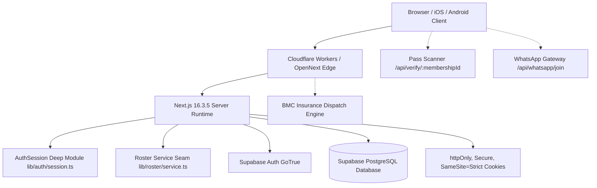

# KCLMC Platform: Comprehensive Session Handover & Architecture Guide

> **Last Updated**: October 2026 (Season 2026–2027)  
> **Repository Directory**: `/Users/rem/Documents/Rem-Vault/KCLMC/kclmc-platform`  
> **Current Git Commit**: `43d3ecf` (Working tree clean across all branches & remotes)  
> **Test Status**: **229 / 229 passing** (`npm test`) | **86 / 86 security tests passing** (`npm run test:security`)  
> **Edge Bundle**: Built and verified (`npm run build:worker` -> `.open-next/worker.js`)  
> **Cloudflare Worker**: `kclmc-portal` (Deployed: Version `1ef59e73-9d08-42b0-8b72-d2535a4783e5`)  
> **Live Deployments**: [kclmc.org](https://kclmc.org) • [kclmc-portal.remy-preston.workers.dev](https://kclmc-portal.remy-preston.workers.dev)

---

## 1. Executive Summary & Project Purpose

The **KCLMC Platform** is the official digital infrastructure for the **King's College London Mountaineering & Climbing Club (KCLMC)**, an accredited student society of King's College London Students' Union (KCLSU, Registered Charity No. 1136729).

### Core Features & Modules
1. **Digital Climbing Membership Pass (`/membership`)**:
   - Real-time pass issuance for active student climbers with cryptographic QR code validation for partner climbing walls and trip leaders.
   - Matches against the official `kclsu_roster` database (Social vs. Recreational membership tiers).
   - **Anti-Forgery & Blank Card Protection**: Card template rendered with CSS `background-image` and touch-callout suppression (`-webkit-touch-callout: none`, `pointer-events: none`) to prevent blank template extraction on mobile long-press.
   - **Cross-Platform Save**: Native Web Share API (`navigator.share`) with Canvas Blob fallback for seamless saving to Apple Photos / Android Gallery.
2. **Compulsory Safety Gate & Emergency Directory (`/safety`)**:
   - Hard gating of digital passes behind compulsory BMC Climbing Risk Statement acknowledgment.
   - Collects member phone number and emergency contact (name, phone, relationship) before pass activation.
   - Dual-schema compatibility supporting both unified JSON objects and individual database fields (`emergency_contact_name`, `emergency_contact_phone`, `emergency_contact_relation`).
   - UK GDPR-compliant emergency directory in the admin portal for trip leaders and safety officers.
3. **British Mountaineering Council (BMC) Insurance System (`/admin/bmc`, `/api/admin/bmc-insurance`)**:
   - Automated BMC recreational member civil liability insurance declaration workflow.
   - Prevents duplicate declarations, issues verification badges on digital passes.
   - Edge-safe chunked batch emailing with resilient timeout and dispatch reconciliation.
4. **Leak-Proof WhatsApp Community Gateway (`/api/whatsapp/join`)**:
   - Server-side gateway protecting society WhatsApp group links from public search indexing and web scrapers.
   - Restricts community invite access strictly to verified, authenticated members with paid passes.
   - Zero-link vCard contact generation for admin broadcasts and phonebook exports (`/admin/export`).
5. **Where We Climb (`/guides`)**:
   - Comprehensive guide directory for London indoor climbing centres (Mile End, Castle, Parthian, VauxWall, Bermondsey Wall, HarroWall) with exclusive student discount information and crag beta.
6. **Apparel Drops & Stash (`/drops/kclmc`)**:
   - Group-buy merchandise pre-order system with live MOQ (Minimum Order Quantity) tracking.
7. **Trips & Meets (`/trips`)**:
   - Mountaineering, trad, and bouldering trip calendar (Peak District, Harrison's Rocks, Portland, Font, Highlands).
8. **Bio Links Directory (`/links`)**:
   - Mobile-first, high-conversion Linktree alternative designed in KCLMC Green & Gold (`#041F1E`, `#052322`, `#FFBD59`).
   - Bypasses global site chrome for maximum mobile retention, featuring official crest, quick social icon row, and interactive link cards with prominent gold pulse highlight styling.
   - Dynamic database backing via `portal_links` table with fallback to `DEFAULT_PORTAL_LINKS` and real-time committee CMS controls at `/admin/content`.
9. **Registration & Auth UX (`/login`)**:
   - Segmented top controls (`[ Sign In ]` | `[ Create Account ]`) eliminating member confusion.
   - KCLSU separation explanatory banner clarifying that union shop transactions require creating a portal account.
   - Inline "First time visiting the portal? Create account →" one-click helper on failed credential attempts.
10. **Associate Member System (`ASSOC-26XX`)**:
    - Dedicated custom ID generator and membership linking toggle for non-King's climbers (alumni, UoL, staff, guests).
11. **Committee Administration Portal (`/admin`)**:
    - **Payment Reconciliation (`/admin/reconcile`)**: 3-tier CSV reconciliation engine matching KCLSU payment reports against membership and merchandise orders.
    - **Pass Scanner (`/admin/scan`)**: Mobile QR and barcode scanner for committee check-ins at climbing walls.
    - **Content Manager (`/admin/content`)**: Manage trips, guides, merchandise drops, and bio links.
    - **Manufacturer Export (`/admin/export`)**: Sizing matrix generator for garment printers and structured vCard generation (`KCLMC 26/27`).
    - **Modules & Permissions (`/admin/modules`)**: Dynamic route access and feature flags.

---

## 2. Technology Stack & Edge Architecture



- **Framework**: Next.js 16.3.5 (App Router, webpack bundler).
- **Edge Deployment**: Cloudflare Workers via OpenNext (`@opennextjs/cloudflare` v1.20.6, `workerd` compatibility date `2026-06-12`).
- **Database & Auth**: Supabase PostgreSQL with `@supabase/ssr` v0.12.7 and `@supabase/supabase-js` v2.117.0.
- **Styling**: Tailwind CSS 3.4.19, custom topo pattern textures, brand typography (Barlow Condensed, Inter, Space Mono).
- **Brand Palette**:
  - Alpine Forest Teal: `#052322` (primary background), `#041F1E` (surface dark), `#084746` (borders & cards).
  - Summit Gold: `#FFBD59` (primary accents, links, buttons, active states).
  - Deep Pine: `#084746`.
- **Official Crest**: Circular dark green emblem with white "KCL MC" text and climber hanging from 'K' (`public/images/kclmc-logo.png`). Note: "Est. 1928" was removed across the entire codebase as it was an unverified template placeholder.

---

## 3. Git Topology & Remotes

The project is hosted across two GitHub remotes and must always be kept synchronized:

```text
origin: https://github.com/RemTypes/kclmc-platform.git
portal: https://github.com/RemTypes/kclmc-portal.git
```

### Active Branches (All synchronized at commit `c2f4880`):
- `main`: Canonical production codebase (deployed to `kclmc.org`).
- `cloudflare-preview`: Deployed Cloudflare preview environment.
- `portal-clean`: Tracking branch for `portal/main`.

### Sync Command Pattern:
```bash
git checkout main
git add -A && git commit -m "your message"
git push origin main && git push portal main
git checkout cloudflare-preview && git merge main && git push origin cloudflare-preview && git push portal cloudflare-preview
git checkout main
```

---

## 4. Key Architectural Implementations & Security Hardening

### A. Authentication & Session Hardening
1. **`AuthSession` Deep Module (`lib/auth/session.ts`)**:
   - Encapsulates authentication, rate limiting, and 2FA challenge handling behind a clean, testable domain service seam.
2. **`httpOnly` Session Token Isolation (`lib/security/cookies.ts`)**:
   - Session tokens are strictly stored in `httpOnly: true, secure: true, sameSite: 'strict'` cookies to eliminate XSS risks.
   - Client JS cannot access auth cookies. Authenticated client components communicate via `/api/auth/me` or `/api/membership`.
3. **Two-Factor Authentication (2FA/OTP) (`lib/security/two-factor.ts`)**:
   - **Mandatory for Committee / Admin Accounts (`role >= 1`)**.
   - RFC 6238 TOTP authenticator app support with QR code setup on first login.
   - 8 single-use 8-character backup codes (`XXXX-XXXX`) with automatic burn-on-use.
   - Sealed stateless challenges using AES-256-GCM so login challenges survive across Cloudflare edge worker isolates ([ADR 0001](file:///Users/rem/Documents/Rem-Vault/KCLMC/kclmc-platform/docs/adr/0001-stateless-aes-gcm-2fa-challenges.md)).
   - Enrolled secrets and hashed backup codes stored in `auth.users.raw_user_meta_data`.
4. **Fixed 2FA Submission & View Transition Safety (`app/(auth)/login/page.tsx`)**:
   - Resolved button freezing in `"VERIFYING 2FA..."` by guaranteeing `setLoading(false)` on view transitions and auth responses.
   - Automatic `useEffect` watcher clears loading state and stale errors whenever the view switches.
   - `navigateToDestination` includes a micro-delay ensuring browser network threads commit `Set-Cookie` headers before executing navigation.
5. **Rate Limiting, Account Lockout & CAPTCHA (`lib/security/rate-limiter.ts`)**:
   - Max 5 failed attempts per 15 minutes by IP or account.
   - Account lockout with exponential backoff on 5+ failures.
   - Anti-bot CAPTCHA challenge triggered after 3 failures.
6. **Strict Password Policy (`lib/security/password-policy.ts`)**:
   - Min 12 characters, uppercase, lowercase, numbers, symbols, and rejection of the top 10,000 common passwords.

### B. Member Roster Service Seam & Curated Names (`lib/roster/service.ts`)
- Reconciles membership passes and handles missing names using a 4-layer fallback strategy:
  1. Live profile link (`user_id -> profiles`).
  2. Curated name table (`kclsu_roster_curated_names`, migration `008_roster_curated_names.sql`).
  3. KCLSU roster raw cardholder entry.
  4. Student ID masked fallback.
- Architecture Decision Record documented in [ADR 0002](file:///Users/rem/Documents/Rem-Vault/KCLMC/kclmc-platform/docs/adr/0002-storage-adapter-seam-for-roster.md).

### C. Access Control & Authorization (RBAC)
- `middleware.ts` enforces `role >= 1` for `/admin` pages, `/api/reconcile`, `/api/roster`, and `/api/telemetry`.
- `getAuthenticatedUserRole(supabase, user)` in `lib/auth.ts` validates the user against committee email whitelists and the Supabase `profiles` table.
- System status page (`/status` and `/api/health`) is restricted to committee accounts to prevent infrastructure enumeration.

### D. Database RLS Hardening (`supabase/migrations/006_harden_roster_rls.sql`)
- Revoked unrestricted public `select` on `kclsu_roster`.
- Direct table `SELECT` is restricted to `user_id = auth.uid()` and `get_user_role() >= 1`.
- Public wall scanners query the dedicated RPC function `verify_membership_card(card_num)` which returns strictly `{ is_valid, full_name, tier, academic_year }` without leaking transaction IDs or student PII.

### E. Digital Membership Card Protection
- Implemented in `components/MembershipCard.tsx`.
- Card template uses CSS `background-image` with `pointer-events: none` and `-webkit-touch-callout: none`.
- Prevents malicious users from saving a blank membership card template via mobile long-press to fabricate unauthorized passes.
- Save button leverages `navigator.share({ files: [blob] })` on iOS/Android for 1-tap save to photos, falling back to Canvas Blob download on desktop.

### F. HTTP Security Headers (`next.config.mjs`)
- Configured:
  - `X-Frame-Options: DENY`
  - `X-Content-Type-Options: nosniff`
  - `Referrer-Policy: strict-origin-when-cross-origin`
  - `Permissions-Policy: camera=(), microphone=(), geolocation=()`
  - `Strict-Transport-Security: max-age=31536000; includeSubDomains; preload`

### G. Dynamic Browser Tab Titles & SEO Metadata
- Base template in `app/layout.tsx`: `title: { default: "KCLMC | Mountaineering & Climbing", template: "%s | KCLMC" }`.
- Route layouts export section titles (`Digital Membership Pass`, `Where We Climb`, `Trips & Meets Calendar`, `Club Merch`, `Sign In`, `Committee Admin Portal`, `Pass Scanner`, etc.).
- `app/(kclmc)/membership/page.tsx` dynamically sets `document.title` to the member's name upon login: `Alex Honnold | Pass | KCLMC`.

---

## 5. Critical Engineering Rules & Gotchas

> [!CAUTION]
> **1. macOS iCloud Drive Conflict Files**:
> When editing files in iCloud-synced directories, conflict files named `* 2.*` or `* 3.*` (e.g. `cache-life.d 2.ts` or `routes.d 2.ts`) can be created by macOS sync. These cause TypeScript duplicate identifier errors.
> **Fix**: Run:
> ```bash
> find . \( -name "* 2.*" -o -name "* 3.*" \) -delete
> ```

> [!IMPORTANT]
> **2. `httpOnly` Cookies vs Client-Side Supabase SDK**:
> `@supabase/ssr` default configuration uses `httpOnly: false`. However, all session cookies are hardened to `httpOnly: true`.
> - Client components (`'use client'`) CANNOT read session tokens via `document.cookie` or `createBrowserClient().auth.getUser()`.
> - Always route authenticated client reads/writes through Next.js server route handlers (`/api/auth/me`, `/api/membership`), which automatically receive cookies in request headers.

> [!WARNING]
> **3. Cloudflare Worker Name & Free Plan Limits**:
> In `wrangler.jsonc`, the Worker name is configured as `"name": "kclmc-portal"` (matching Cloudflare CI expectations).
> Do NOT add `"limits": { "cpu_ms": ... }` to `wrangler.jsonc` — CPU limits are not supported on Cloudflare Workers Free plan and will cause deployments to fail with error `[code: 100328]`.

> [!NOTE]
> **4. Cloudflare Worker Secrets**:
> `wrangler.jsonc` defines build-time public variables (`NEXT_PUBLIC_SUPABASE_URL`, `NEXT_PUBLIC_SUPABASE_ANON_KEY`, `SUPERADMIN_EMAIL`, `COMMITTEE_EMAILS`, `WHATSAPP_COMMUNITY_INVITE_URL`).
> `SUPABASE_SERVICE_ROLE_KEY` MUST be configured as an encrypted secret in the Cloudflare Dashboard:
> ```bash
> npx wrangler secret put SUPABASE_SERVICE_ROLE_KEY
> ```

---

## 6. Pre-Publish Dashboard Verification Checklist

Before taking new features live publicly, verify these settings in the Supabase & Cloudflare dashboards:

| Item | Service | Action Required | Status |
| :--- | :--- | :--- | :--- |
| **RLS Migration 006** | Supabase | Execute `supabase/migrations/006_harden_roster_rls.sql` in SQL Editor to lock down `kclsu_roster`. | Verified |
| **Curated Names Migration 008** | Supabase | Execute `supabase/migrations/008_roster_curated_names.sql` for missing member name resolution. | Verified |
| **Site URL & Redirects** | Supabase | Set Site URL to `https://kclmc.org` and add `https://kclmc.org/auth/callback**` in Auth URL Configuration. | Verified |
| **Custom SMTP** | Supabase | Configure custom SMTP (Gmail/Purelymail/Resend) to prevent Supabase Free tier 3 emails/hr limit. | Configured |
| **Service Role Secret** | Cloudflare | Verify `SUPABASE_SERVICE_ROLE_KEY` exists in Cloudflare Worker secrets. | Verified |
| **Worker Name** | Cloudflare | Configured as `kclmc-portal` in `wrangler.jsonc` without CPU limits block. | Verified |

---

## 7. Useful Commands Reference

```bash
# Run complete test suite (211 unit, integration & checklist tests)
npm test

# Run dedicated security test suite (86 tests covering RLS, RBAC, 2FA, anti-forgery, injection)
npm run test:security

# Run TypeScript type check
npx tsc --noEmit

# Run Next.js production build
npm run build

# Build OpenNext Cloudflare Edge Worker bundle
npm run build:worker

# Deploy to Cloudflare Worker via Wrangler
npx wrangler deploy

# Clean untracked iCloud duplicate conflict files
find . \( -name "* 2.*" -o -name "* 3.*" \) -delete

# Run database GDPR backup script
npm run backup
```

---

*This document serves as the authoritative handover. A new chat model or engineer can ingest this file to immediately continue development without missing any context.*
