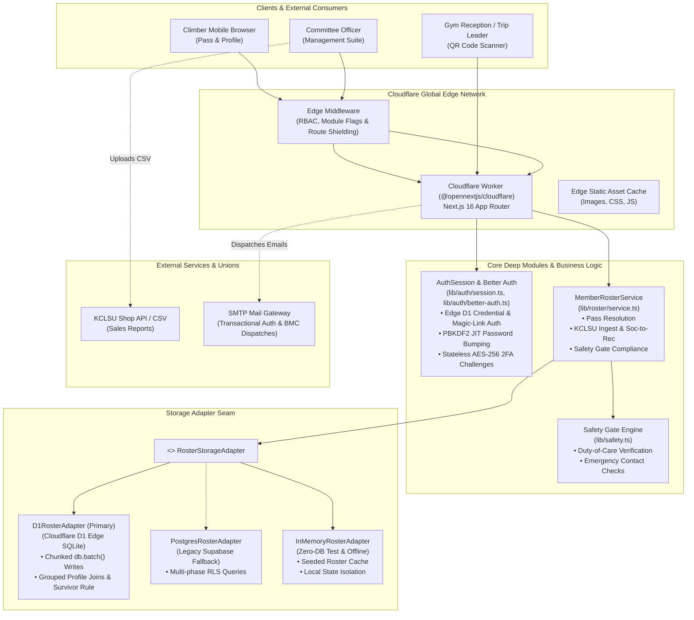
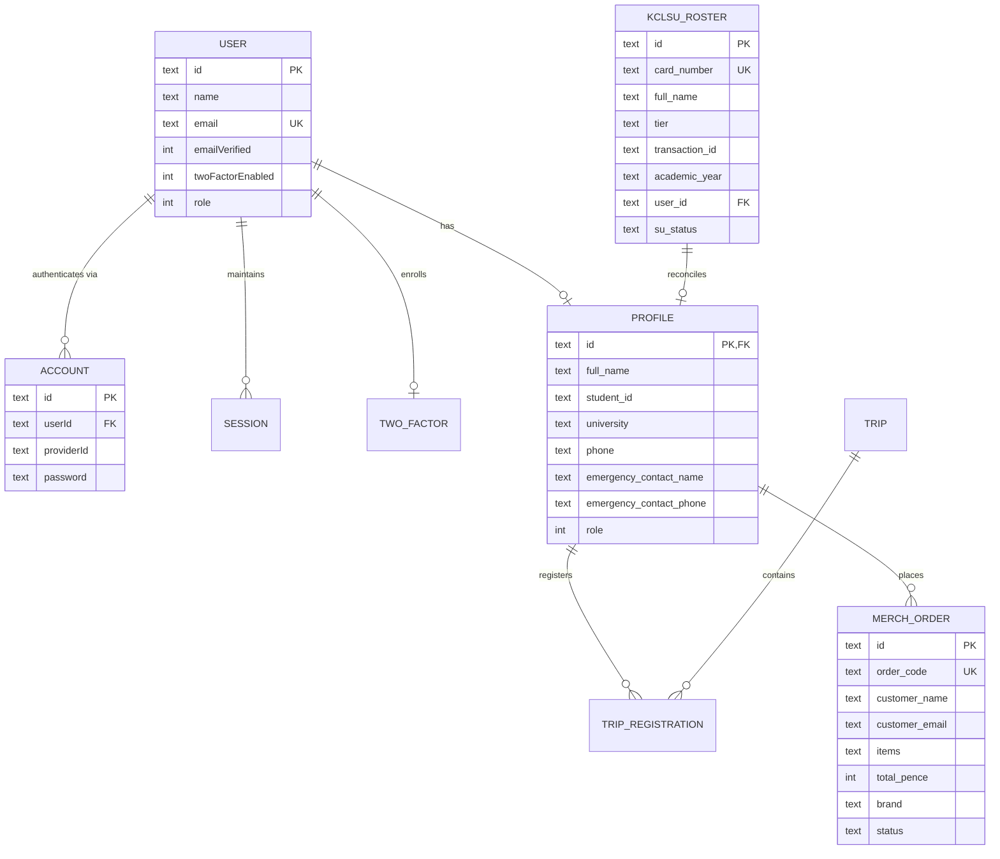

# KCLMC Platform: Architecture & System Design

**Author**: Remy Preston  
**Platform**: King's College London Mountaineering Club (KCLMC) & London Universities Bouldering Event (LUBE)  
**Deployment Target**: Cloudflare Workers via `@opennextjs/cloudflare`  
**Database & Auth**: Cloudflare D1 (Edge SQLite) + Better Auth (Primary) with Offline In-Memory Fallback  

---

## 1. System Overview

The KCLMC Platform is an edge-first, high-resilience web application that serves as the central operations and compliance engine for King's College London's outdoor society and the intercollegiate London Universities Bouldering Event (LUBE) league.

The platform bridges university administration, safety duty-of-care, real-time climbing wall verification, and event scoring:

---

## 2. Core Architectural Principles

The platform follows clean software engineering principles:

### A. Deep Modules Over Shallow Abstractions
Rather than scattering business logic across thin utility functions or leaky controllers, functionality is consolidated into **deep modules** that provide high leverage through simple interfaces while concealing substantial implementation complexity:

1. **[`MemberRosterService`](../lib/roster/service.ts)**:
   - **Interface**: Exposes concise operations: `resolveMemberPass()`, `linkStudentId()`, `verifyPass()`, `updateSafetyNotes()`, `listRoster()`, and `syncRoster()`.
   - **Concealed Complexity**: Multi-phase database lookups, cross-table joins between union card numbers and member profiles, "Social-to-Recreational" upgrade state resolution (Survivor Rule), CSV formula injection neutralization, and circuit-breaker failover across Cloudflare D1, legacy Postgres, and in-memory adapters.
2. **[`AuthSession`](../lib/auth/session.ts)**:
   - **Interface**: Exposes `authenticateCredentials()`, `verifyTwoFactor()`, and `toApiResponse()`.
   - **Concealed Complexity**: Better Auth credential verification on Cloudflare D1, automatic JIT PBKDF2 password hash bumping (`lib/security/password-hasher.ts`) for migrated accounts, sliding-window IP/email rate limiting (with isolated `2fa:${ip}` buckets), exponential backoff with account lockout, Cloudflare Turnstile CAPTCHA threshold triggers, mandatory committee 2FA evaluation, RFC 6238 TOTP verification ($\pm 2$ step window), single-use backup code burning, and stateless AES-256-GCM challenge token encryption.

### B. Storage Adapter Seams
To eliminate tight coupling to any single database vendor and enable zero-mock, sub-second testing:
- **Interface**: [`RosterStorageAdapter`](../lib/roster/service.ts) defines storage operations for climber profiles, purchases, passes, and verification.
- **Implementations**:
  - `D1RosterAdapter` ([`lib/roster/d1-adapter.ts`](../lib/roster/d1-adapter.ts)): Primary production adapter communicating natively with Cloudflare D1 (`kclmc-production`) via parameterized SQLite queries, chunked `db.batch()` execution, and deduplicated profile joins.
  - `PostgresRosterAdapter`: Transitional fallback adapter for Supabase PostgreSQL.
  - `InMemoryRosterAdapter`: Backed by an in-memory map and canonical seed data, enabling unit and security tests to run completely isolated without network latency.
- Documented in [ADR 0002: Storage Adapter Seam for Roster Reconciliation and Pass Verification](adr/0002-storage-adapter-seam-for-roster.md).

### C. Stateless Distributed 2FA Challenges
Cloudflare Workers run in ephemeral, globally distributed V8 isolates. Storing multi-step authentication state in database tables introduces latency and isolate fragmentation:
- Ephemeral 2FA challenge state is sealed using **AES-256-GCM** encryption with authenticated tags and a deterministic cross-isolate fallback key.
- The challenge token is returned as an encrypted HTTP-only cookie (`kclmc_2fa_pending`) with `SameSite=Lax`, `Secure`, and a 5-minute time-to-live.
- Any Cloudflare edge node can unseal and verify the second factor without database round-trips for challenge state, reading and persisting the user's TOTP secret directly in Cloudflare D1 (`"twoFactor"` and `users` tables).
- Documented in [ADR 0001: Stateless AES-GCM 2FA Challenges](adr/0001-stateless-aes-gcm-2fa-challenges.md).

---

## 3. Security & Compliance Architecture

The platform operates in a high-liability collegiate sports environment, necessitating defense-in-depth:

| Security Domain | Implementation | Defense Strategy |
| :--- | :--- | :--- |
| **Authentication & 2FA** | `lib/security/two-factor.ts` | Mandatory TOTP 2FA for all committee officers (Role ≥ 1); single-use 8-character hashed backup codes; $\pm 60\text{s}$ drift window; isolated `2fa:${ip}` rate-limit bucket. |
| **Brute-Force & Credential Stuffing** | `lib/security/rate-limiter.ts` | Sliding-window tracker prioritizing `cf-connecting-ip` + email; exponential backoff after 3 failures; full 15-minute account lockout after 5 failures; Cloudflare Turnstile CAPTCHA verification. |
| **Timing Attacks** | `crypto.timingSafeEqual` | Constant-time buffer comparisons for all tokens, OTP codes, and backup hashes. |
| **CSV Formula Injection** | `lib/roster.ts` (`sanitizeCsvCell`) | Strips formula prefixes (`=`, `+`, `-`, `@`) when parsing or exporting membership files. |
| **PII Redaction & Bounds** | `app/api/verify/[membershipId]/route.ts` | Masks student IDs to last 3 digits (`***789`), strips union transaction IDs on public verification, and enforces regex bounds (`^[A-Z0-9_-]{3,32}$`). |
| **Server-Side RBAC & Module Guards** | `middleware.ts`, `app/admin/ml/layout.tsx` | Enforces `role >= 1` on `/admin` and `/api/orders`, `role >= 2` on `/admin/ml`, and blocks disabled feature modules at both Edge Middleware and API layers. |
| **Duty-of-Care Safety Gate** | `lib/safety.ts` | Digital climbing pass is gated until mobile number and emergency contacts are provided, satisfying UK climbing wall duty-of-care requirements. |

---

## 4. Domain Model & Unified D1 Schema

The platform domain is strictly specified in [`GLOSSARY.md`](../GLOSSARY.md) and persisted in [`d1/schema.sql`](../d1/schema.sql):

---

## 5. Machine Learning Subsystem

Located in `ml/` and restricted to SuperAdmin (`role >= 2`):
1. **Demand Elasticity Modeling (`ml/01_demand_elasticity.py`)**: Estimates price elasticity of demand ($\epsilon$) across historical club merchandise drops (tees, hoodies, fleeces) to forecast pre-order volumes and break-even MOQ (Minimum Order Quantity) thresholds.
2. **Sizing Distribution Optimization (`ml/02_sizing_optimization.py`)**: Uses historical apparel sizing data and student demographic distributions to predict optimal garment size ratios (XS to XXL), reducing overstock waste and stockouts.

---

## 6. Testing Architecture

The test suite runs via [Vitest](https://vitest.dev/) with 100% offline isolation:

- **22 Test Suites / 328 Automated Tests**:
  - `tests/security.test.ts` (90 tests): Comprehensive vulnerability audit covering rate limiting, lockout, Turnstile CAPTCHA, timing-attack resistance, password strength policies, RBAC, and SQL/XSS bounds.
  - `tests/d1_adapter.test.ts`: Cloudflare D1 adapter operations, chunked batching, Survivor Rule upgrades, and duplicate profile join deduplication.
  - `tests/two_factor_enforcement.test.ts`: Cross-isolate 2FA challenge sealing, $\pm 2$ step TOTP drift tolerance, and `2fa:${ip}` rate-limit isolation.
  - `tests/better_auth_engine.test.ts`: Better Auth Kysely D1 engine and session resolution.
  - `tests/password_hasher.test.ts`: PBKDF2 hashing and JIT password bumping in D1.
  - `tests/auth_session.test.ts`: Edge session lifecycle, 2FA challenge encryption, and cookie issuance.
  - `tests/member_roster.test.ts` & `tests/roster.test.ts`: Pass resolution, linking collision prevention, and tier upgrade logic.
  - `tests/verify_pass.test.ts`: Wall scanner pass validation, rate limiting, and PII masking.
  - `tests/portal_links.test.ts`: Bio links CMS visibility and ordering.
  - `tests/bmc_insurance.test.ts`: Insurance mail-merge generation and deduplication.
  - `tests/release_checklist.test.ts`: Pre-release production readiness and environment guards.
