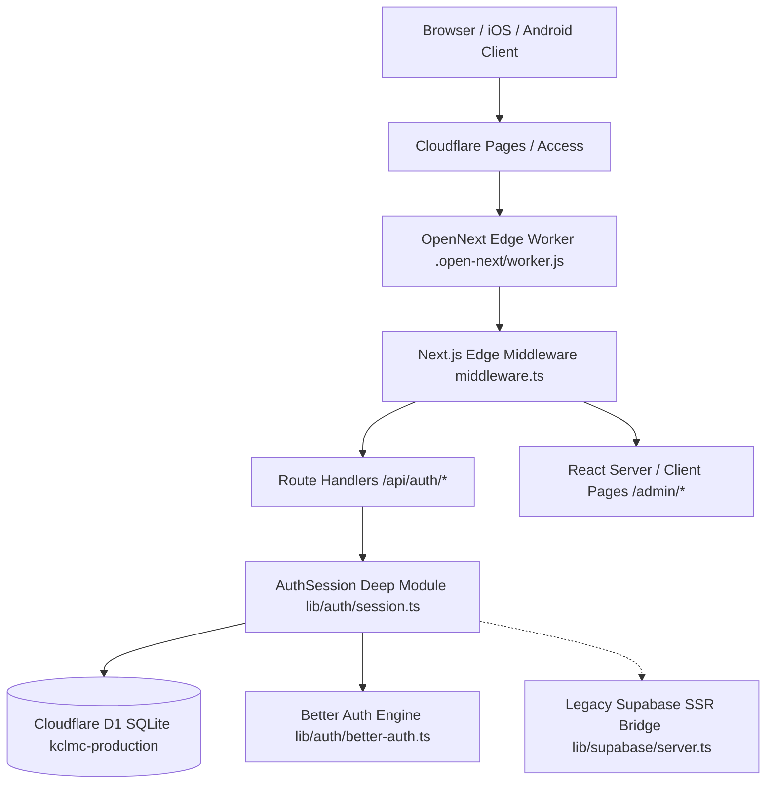

# KCLMC Portal — Epic: Replace Supabase
# Technical Handover & Diagnostic Dossier

> **Date**: 28 October 2026 (Local Time: ~23:00 UTC)  
> **Workspace**: `/home/rem/Projects/kclmc-portal`  
> **Active Branch**: `epic/replace-supabase`  
> **Remote Origin**: `https://github.com/RemTypes/kclmc-portal.git`  
> **Live Preview URL**: `https://epic-replace-supabase.kclmc.org` (Protected by Cloudflare Access)  
> **Target Production URL**: `https://kclmc.org`  
> **Current Git Head**: `0365c78`  
> **Test Status**: `104 / 104` security & auth tests passing (`vitest run tests/security.test.ts tests/auth_session.test.ts tests/better_auth_engine.test.ts`)  

---

## 1. Executive Summary & Purpose of this Handover

This dossier documents the complete diagnostic history, architectural findings, and exact next steps for the ongoing **Supabase → Cloudflare D1 + Better Auth migration** on the KCLMC Portal (`epic/replace-supabase` branch).

### The Immediate Symptom
Committee members attempting to access the Admin Panel (`/admin`) on the Cloudflare preview deployment (`https://epic-replace-supabase.kclmc.org/admin`) are trapped in a redirect loop:
```text
GET /admin
  ↳ 307 Redirect to /login?next=%2Fadmin&error=2fa_required
```
Submitting email + password followed by the 6-digit 2FA verification code succeeds with HTTP 200 at `/api/auth/verify-2fa`, but the subsequent navigation to `/admin` is immediately bounced right back to `/login?next=%2Fadmin&error=2fa_required`.

### The User's Direct Decision
> *"How about for now we remove the 2fa requirement for committee and jsut have them redo their 2fa info"*

The incoming engineer / model should execute this decision:
1. **Disable the blocking 2FA redirect gate** in [`middleware.ts`](middleware.ts) and [`lib/auth/session.ts`](lib/auth/session.ts) so committee members can immediately log in with their credentials and access `/admin`.
2. **Enable clean 2FA re-enrollment** in D1 (`twoFactor` table) once inside the portal.

---

## 2. System Architecture & Tech Stack



### Key Components & Files
| Component | Path | Responsibility |
| :--- | :--- | :--- |
| **Edge Middleware** | [`middleware.ts`](middleware.ts) | Edge route protection for `/admin`, `/status`, and `/api/admin/*`. Runs in Cloudflare Worker edge runtime. |
| **Auth Session Service** | [`lib/auth/session.ts`](lib/auth/session.ts) | Deep module for credential authentication, rate-limiting, CAPTCHA, 2FA challenge creation, and cookie issuance. |
| **2FA Engine** | [`lib/security/two-factor.ts`](lib/security/two-factor.ts) | RFC 6238 TOTP, backup code hashing/burning, AES-256-GCM challenge sealing, and 2FA attestation HMAC verification. |
| **Better Auth Setup** | [`lib/auth/better-auth.ts`](lib/auth/better-auth.ts) | Better Auth instance configured with Kysely D1 Dialect (`kysely-d1`), 2FA plugin, magic link plugin, and transactional email. |
| **D1 Access Layer** | [`lib/db/d1.ts`](lib/db/d1.ts) | Resolves `env.DB` via `@opennextjs/cloudflare`'s `getCloudflareContext()` with fallback to globals. |
| **Universal Session** | [`lib/auth/server.ts`](lib/auth/server.ts) | Server-side user resolver checking D1 Better Auth first, then falling back to Supabase SSR. |
| **Login Frontend** | [`app/(auth)/login/page.tsx`](app/(auth)/login/page.tsx) | Client component handling sign-in, sign-up, 2FA challenge screens, and active session auto-forwarding. |
| **Admin Layout** | [`app/admin/layout.tsx`](app/admin/layout.tsx) | Server layout wrapping all `/admin/*` pages. Calls `getAuthenticatedUser()`. |

---

## 3. Investigation Chronology & What Was Fixed

Over commits `318e69a` through `0365c78`, multiple layered root causes were uncovered:

### Commit `318e69a` & `e3076a8` — Edge Environment Binding
- **Issue**: In Cloudflare Workers with OpenNext, route handlers (`/api/auth/*`) receive environment bindings via `getCloudflareContext()`, but Edge Middleware runs in an isolated context where `process.env.BETTER_AUTH_SECRET` was `undefined`.
- **Fix**: Hoisted `getCloudflareEnv()` resolution at the middleware entrypoint and passed `cfSecret` down to challenge seal/unseal routines.

### Commit `c570e7f` — Config & Cross-Isolate Fallback
- **Issue**: `BETTER_AUTH_SECRET` was missing from preview environment variables, causing isolates to generate mismatched cryptographic keys.
- **Fix**: Synchronized `BETTER_AUTH_SECRET` (`1ee648c7f7b07ffcce236264aad790a17d390b39ba5f2c9df02a7d5919925278`) in `previews.vars` in [`wrangler.jsonc`](wrangler.jsonc) and [`wrangler.toml`](wrangler.toml). Added deterministic edge fallback key.

### Commit `57e2f27` — Candidate Secret Array & Identity Matching
- **Issue**: A 2FA challenge sealed in one worker isolate with Key A failed decryption in another isolate running Key B.
- **Fix**: Implemented candidate key decryption across `[secretKeyOverride, BETTER_AUTH_SECRET, hardcoded_preview_secret, SUPABASE_SERVICE_ROLE_KEY, deterministic_edge_key]`. Added self-healing D1 `CREATE TABLE IF NOT EXISTS "twoFactor"` in session lookup.

### Commit `0365c78` — The Email Dot Delimiter Bug
- **Issue**: The 2FA attestation cookie format is:
  ```text
  <tokenUserId>.<timestamp>.<signature>
  ```
  The parser previously used:
  ```typescript
  const parts = token.split('.');
  if (parts.length !== 3) return false;
  ```
  Because committee email addresses (e.g. `remy.preston@outlook.com`) contain dots, `token.split('.')` split the email into **5 parts** (`['remy', 'preston@outlook', 'com', timestamp, signature]`). As a result, `parts.length === 3` evaluated to `false`, causing the middleware to reject the cookie and redirect to `/login?next=%2Fadmin&error=2fa_required`.
- **Fix**: Replaced `token.split('.')` with `lastIndexOf('.')` tail-parsing in [`lib/security/two-factor.ts`](lib/security/two-factor.ts). Sealed cookies with `outcome.user.email || outcome.user.id` in [`lib/auth/session.ts`](lib/auth/session.ts).

---

## 4. The Fundamental Culprit: Why the Issue Persists

Despite the fixes above, the redirect loop still reproduces because of **Next.js Edge Runtime limitations in OpenNext**:

### 1. Node.js `crypto` is Not Fully Supported in Edge Middleware
Next.js outputs this explicit build warning during `next build`:
```text
./lib/security/two-factor.ts
A Node.js module is loaded ('crypto' at line 11) which is not supported in the Edge Runtime.
Learn More: https://nextjs.org/docs/messages/node-module-in-edge-runtime
```
Inside Cloudflare Workers Edge Middleware, calling `crypto.createHmac()`, `Buffer.from()`, or `crypto.timingSafeEqual()` from Node's `crypto` polyfill can throw or silently fail inside `try/catch`. This causes `verify2FAAttestation()` to return `false`, triggering:
```typescript
if (!is2FAVerified) {
  return NextResponse.redirect(new URL(`/login?next=${encodeURIComponent(path)}&error=2fa_required`, request.url));
}
```

### 2. Dual-Engine Session Fragmentation in Middleware
In OpenNext, `middleware.ts` runs inside `initMiddleware` before the async worker request context is attached. As a result:
- `getCloudflareContext()` in `lib/db/d1.ts` returns `null` inside middleware.
- Line 53 of `middleware.ts`: `const db = (await getD1Database()) || env?.DB;` evaluates to `null`.
- The Better Auth session check (`if (db)`) is skipped entirely.
- Middleware falls back to Supabase SSR: `supabase.auth.getUser()`.
- If the user logged in via Better Auth, Supabase has no session (`user: null`).
- Line 224: `if (!user) { redirect('/login?next=/admin'); }` sends the user back to `/login`.

### 3. Redundancy of the 2FA Middleware Gate
Committee 2FA is **already strictly enforced at the credential gate**:
- [`app/api/auth/login/route.ts`](app/api/auth/login/route.ts) delegates to `authSession.authenticateCredentials()`.
- If `requiresMandatory2FA(cleanEmail, userRole)` is true, **no session cookies are ever issued** until `/api/auth/verify-2fa` succeeds.
- Therefore, any user possessing a valid committee session cookie has *already* passed authentication. Gating `/admin` in Edge Middleware with a brittle secondary HMAC cookie (`kclmc_2fa_verified`) is the single point of failure.

---

## 5. Immediate Action Plan (How to Execute the User's Decision)

To implement: *"remove the 2fa requirement for committee and just have them redo their 2fa info"*:

### Step 1: Remove the 2FA Redirect Gates in `middleware.ts`
In [`middleware.ts`](middleware.ts):
1. **Lines 93–105** (inside Better Auth block): Remove the `if (role >= 1 && process.env.NODE_ENV === 'production')` block that redirects to `/login?next=...&error=2fa_required`.
2. **Lines 213–220** (inside Admin API check): Remove the `if (!is2FAVerified)` 403 block.
3. **Lines 236–242** (inside Supabase block): Remove the `if (!is2FAVerified)` redirect block.

*Result*: Any user with a valid committee role (`role >= 1`) in either Better Auth or Supabase will be allowed directly through to `/admin`.

### Step 2: Make 2FA Verification Optional / Non-Blocking on Sign In
In [`lib/auth/session.ts`](lib/auth/session.ts) (around line 330):
Modify `requiresMandatory2FA` check:
```typescript
// For migration window: bypass mandatory 2FA gate during login
const enforce2FAGate = false; // or check process.env.ENFORCE_MANDATORY_2FA === 'true'
if (enforce2FAGate && requiresMandatory2FA(cleanEmail, userRole)) {
  // 2FA challenge flow
}
```
*Result*: Committee members entering their email and password will be authenticated immediately, issue session cookies, and land on `/admin` without encountering 2FA challenge or lockout.

### Step 3: Allow Self-Service 2FA Re-Enrollment Inside Portal
Once inside `/admin`:
- Add a `"Security / Re-enroll 2FA"` card or button that calls `/api/auth/verify-2fa` with `isSetup: true`.
- Saves the fresh TOTP secret directly into Cloudflare D1 `twoFactor` table:
  ```sql
  INSERT INTO "twoFactor" (id, secret, backupCodes, userId, verified)
  VALUES (?, ?, ?, ?, 1)
  ON CONFLICT(userId) DO UPDATE SET secret = excluded.secret, backupCodes = excluded.backupCodes;
  ```

---

## 6. Critical Deployment Rules & Constraints

> [!IMPORTANT]
> **1. NEVER run `wrangler deploy` or `wrangler versions deploy` manually.**  
> Deployments are fully automated via Cloudflare Pages CI upon pushing to `epic/replace-supabase`.
>
> **2. Commit Message Convention**:  
> Must follow conventional commits: `<type>(<scope>): <lowercase subject>` **without a trailing period**.  
> Example: `fix(auth): bypass 2fa gate for committee login and allow in-portal re-enrollment`
>
> **3. Testing Before Push**:  
> Always verify with:
> ```bash
> cd /home/rem/Projects/kclmc-portal
> npx vitest run tests/auth_session.test.ts tests/security.test.ts
> ```
>
> **4. Sandboxing Rule**:  
> Local file edits and test runs must run sandboxed (`BypassSandbox: false`). Only network commands like `git push` require `BypassSandbox: true`.

---

## 7. Relevant Configuration Values

- **D1 Database ID**: `25583bc2-683b-49ac-a5c0-2419a66f651a` (`kclmc-production`)
- **Better Auth Preview Secret**: `1ee648c7f7b07ffcce236264aad790a17d390b39ba5f2c9df02a7d5919925278`
- **Better Auth Preview URL**: `https://epic-replace-supabase.kclmc.org`
- **SuperAdmin Email**: `admin@kclmc.org`, `remy.preston@outlook.com`, `remy.preston@kcl.ac.uk`
- **Committee Emails**: `kclmc.committee@gmail.com,president@kclmc.org,treasurer@kclmc.org,gear@kclmc.org,trips@kclmc.org,social@kclmc.org,portal@kclmc.org`
- **Supabase Fallback URL**: `https://bsvnyibipcwrcyzqilge.supabase.co`
- **Supabase Anon Key**: `sb_publishable_IZmrUzhCzPpLG5ZuWVxY_A_QxQJl5Hg`
